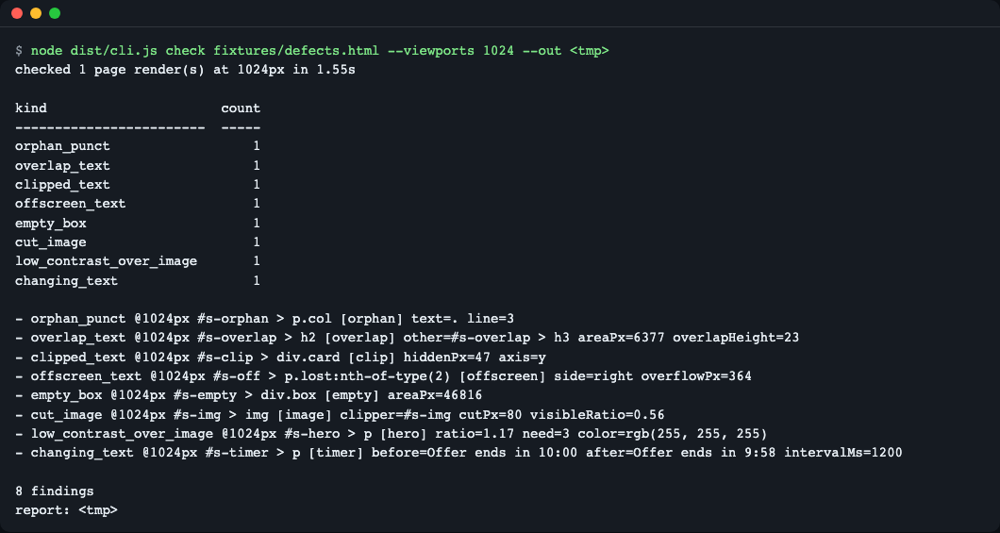
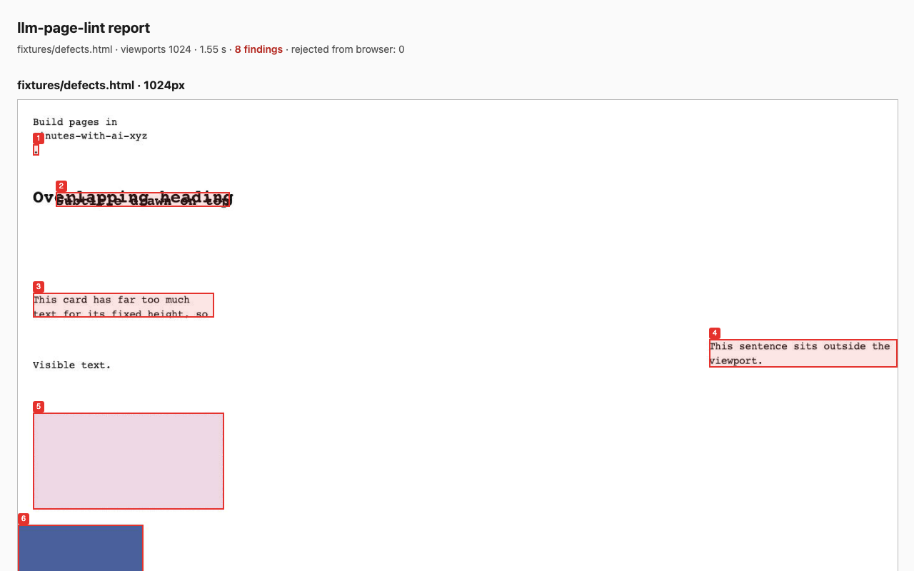
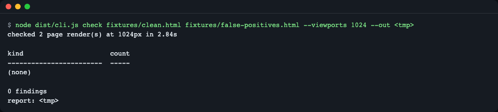
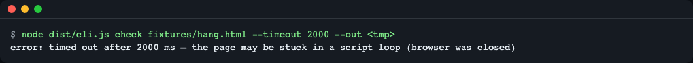
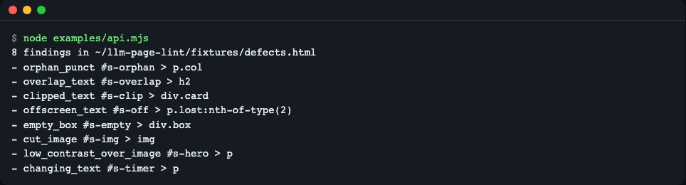
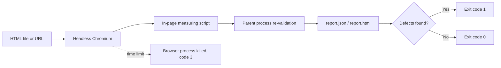

# llm-page-lint

**English** | [한국어](README.ko.md)

A command-line linter that opens an LLM-generated HTML page in headless Chromium and measures 8 kinds of visual defects (overlapping, clipped or off-screen text, empty boxes, cut images, low contrast over images, orphan punctuation, self-changing text) without any reference image. Like a proofreader circling problems in red pen without the correct manuscript, it does this with rules and numbers instead of someone scanning the screen. Use it as a CI gate for AI-generated pages: exit code 1 means defects were found. Run: `git clone https://github.com/LeeGyeongPil/llm-page-lint && cd llm-page-lint && npm ci && npx playwright install chromium --only-shell && npm run build && npm start`. Findings are re-validated in the parent process, and a hard `--timeout` kills the browser so unattended runs cannot hang. A judge-and-fix loop is planned for a later milestone.


*Result of checking a sample page that contains one of each of the 8 defects. It shows the count and location per kind, and since defects exist, the exit code is 1.*

## Who it is for
- People who want to filter HTML made by an LLM (landing pages, reports, slides) automatically, without a person scanning it by eye
- People who want to find broken spots from a single page, without a "reference screenshot"
- People who need a regression-prevention gate in CI for an unattended generate -> check -> fix pipeline

## Installation
Requirements: Node.js 22 or later (`brew install node` or https://nodejs.org). On a minimal Linux environment, the system libraries Chromium needs are required separately, and the `--with-deps` option below installs them (root privileges required).

```bash
git clone https://github.com/LeeGyeongPil/llm-page-lint
cd llm-page-lint
npm ci
npx playwright install chromium --only-shell          # Linux: npx playwright install --with-deps chromium --only-shell
npm run build
```

It is not on the npm registry yet. Clone it as above.

## Quick start
```bash
npm start
```
It checks the built-in sample page (`fixtures/defects.html`) and shows the defect table and the report path. This command is a trial that always ends with exit code 0 (the real `check` returns 1 when there are defects).

To check your own page:
```bash
node dist/cli.js check fixtures/defects.html --viewports 1024 --out /tmp/lint-out
echo $?        # 1 = defects found
```
The actual output is as follows (the same content as the screenshot above).
```
checked 1 page render(s) at 1024px in 1.65s

kind                      count
------------------------  -----
orphan_punct                  1
overlap_text                  1
clipped_text                  1
offscreen_text                1
empty_box                     1
cut_image                     1
low_contrast_over_image       1
changing_text                 1

- orphan_punct @1024px #s-orphan > p.col [orphan] text=. line=3
- overlap_text @1024px #s-overlap > h2 [overlap] other=#s-overlap > h3 areaPx=6377 overlapHeight=23
- clipped_text @1024px #s-clip > div.card [clip] hiddenPx=47 axis=y
- offscreen_text @1024px #s-off > p.lost:nth-of-type(2) [offscreen] side=right overflowPx=364
- empty_box @1024px #s-empty > div.box [empty] areaPx=46816
- cut_image @1024px #s-img > img [image] clipper=#s-img cutPx=80 visibleRatio=0.56
- low_contrast_over_image @1024px #s-hero > p [hero] ratio=1.17 need=3 color=rgb(255, 255, 255)
- changing_text @1024px #s-timer > p [timer] before=Offer ends in 10:00 after=Offer ends in 9:58 intervalMs=1200

8 findings
report: /tmp/lint-out/report.html
```
Each line is `defect kind @viewport width · CSS selector · section name · measurements`. For example, `ratio=1.17 need=3` means the contrast ratio between the text and its background is 1.17 while at least 3 is required.

The `report:` line is printed as an absolute path (`/tmp/lint-out` above is an example). The same folder gets `report.json` (for machines) and `report.html` (for people, with screenshots embedded and no external addresses). `report.html` opens when you double-click the file.


*A page screenshot from `report.html`. The numbered boxes mark defect locations, followed by a per-number defect table and a table of text contrast over images.*

## The 8 defect kinds it catches
What the kind names in the output mean. All thresholds are values in the code (`src/browser/detect.ts`, `src/contrast.ts`), and the verdict uses only these rules, with no reference image.

| Kind | What the screen looks like | How it is measured | Threshold |
|---|---|---|---|
| `orphan_punct` | Only a period, comma or closing bracket is left at the start of a line | Get the actually rendered lines with `Range` and check whether a line from the 2nd on starts with closing punctuation | Starts with 1 closing-punctuation character |
| `overlap_text` | Text from different blocks overlaps and cannot be read | Compute the intersection area between line boxes (lines that are clipped and not drawn are excluded) | Intersection over 20px² |
| `clipped_text` | Text spills out of an `overflow: hidden` box and is cut off | Length by which a line box exceeds the boundary of the clipping box | Over 2px |
| `offscreen_text` | Text is off the left, right or top of the screen | Compare block bounds with the viewport width (inside scroll boxes is excluded) | Over 1px |
| `empty_box` | A large box with background or border but no text or image inside | Whether a styled box contains text or media | Area 5000px² or more |
| `cut_image` | An image straddles a section boundary and only part of it is visible | Intersection of the image rectangle and the clipping ancestor box | Visible ratio over 0.02 and under 0.98, and cut length over 2px |
| `low_contrast_over_image` | Text over a photo or gradient is not distinguishable from the background | Make the text transparent, capture only the background, and compute the contrast ratio (WCAG formula) at the lowest 10% percentile of pixels in the text area | 4.5:1 for normal text, 3:1 for large text (24px or more, or bold 18.66px or more) |
| `changing_text` | Text that changes by itself, like a countdown or a price ticker | Read every text block twice 1.2 seconds apart and compare (first viewport only) | Text differs |

For example, in the earlier `ratio=1.17 need=3`, `need=3` means that text is large, so its threshold is 3:1. The numbers above are values confirmed against the result that `fixtures/defects.html` produces and against the code; to change a rule, look at those two files.

## Usage
| Command / option | What it does | Example |
|---|---|---|
| `check <input...>` | Check. Input is a `.html` file, a folder, or an http(s) URL | `check page.html` |
| `--viewports <list>` | List of screen widths (px). Default 375,768,1280 | `--viewports 375,1280` |
| `--out <folder>` | Where to save the report. Default is `~/.cache/llm-page-lint/runs/` (under `$XDG_CACHE_HOME` if set), and the path is printed on the last line (on Linux, changing only `XDG_CACHE_HOME` also moves the browser location; see the Configuration section below) | `--out /tmp/lint-out` |
| `--json` | Print a JSON report to standard output instead of the summary | `--json > r.json` |
| `--fail-on <kind,...>` | Only these kinds count toward exit code 1; the rest are warnings | `--fail-on clipped_text` |
| `--ignore <selector>` | Exclude that element (and its contents) from the check (repeatable) | `--ignore .ad-slot` |
| `--timeout <ms>` | Overall time limit (default 60000, allowed range 1000-2147483647; outside the range is exit code 2). If the run exceeds it, exit code 3 | `--timeout 2000` |
| `--no-changing-text` | Skip the "changing text" check that reads twice 1.2 seconds apart | |
| `demo` | Check the built-in sample (always exit code 0) | `npm start` |

`refine` (the judge-and-fix loop) is an experimental feature that is not documented yet, so it is outside the scope of this document.

Exit codes: `0` no defects / `1` defects found / `2` usage or runtime error / `3` timeout.

### Scenario 1 — a clean page passes
```bash
node dist/cli.js check fixtures/clean.html fixtures/false-positives.html --viewports 1024 --out /tmp/lint-out
```
```
checked 2 page render(s) at 1024px in 2.89s

kind                      count
------------------------  -----
(none)

0 findings
report: /tmp/lint-out/report.html
```
Exit code 0. `false-positives.html` is a page collecting cases that **look odd but are fine**, such as screen-reader-only hidden text, so it serves to confirm there are no false positives.


*With no defects, you get `(none)` and `0 findings`.*

### Scenario 2 — cut off a stuck page with the time limit
```bash
node dist/cli.js check fixtures/hang.html --timeout 2000 --out /tmp/lint-out
```
```
error: timed out after 2000 ms — the page may be stuck in a script loop (browser was closed)
```
Exit code 3. So that an unattended pipeline does not hang even with a page stuck in an infinite loop, the browser process is terminated directly.


*When the time limit is exceeded, the browser is closed and the run ends with exit code 3.*

### Scenario 3 — treat only some kinds as failures
```bash
node dist/cli.js check fixtures/defects.html --viewports 1024 --fail-on clipped_text --no-changing-text --out /tmp/lint-out
```
Near the last line you get `7 findings (1 count toward the exit code)`. Because `--no-changing-text` removed the changing-text check, there are 7 findings rather than 8, and of those only 1 `clipped_text` counts toward the exit code; the rest are warnings. It is for turning rules on one by one when first adopting the tool.

### Scenario 4 — use it as a library
```js
import { lint } from './dist/index.js';
const file = 'fixtures/defects.html';
const report = await lint({ file }, { viewports: [1024] });
console.log(`${report.findings.length} findings in ${file}`);
for (const f of report.findings) console.log(`- ${f.kind} ${f.selector}`);
```
The repository includes an almost identical example (the only difference is that it prints the file path as an absolute path).
```bash
node examples/api.mjs
```
```
8 findings in <파일 경로>/fixtures/defects.html
- orphan_punct #s-orphan > p.col
- overlap_text #s-overlap > h2
- clipped_text #s-clip > div.card
- offscreen_text #s-off > p.lost:nth-of-type(2)
- empty_box #s-empty > div.box
- cut_image #s-img > img
- low_contrast_over_image #s-hero > p
- changing_text #s-timer > p
```
(`<파일 경로>` is a placeholder for "file path".)


*`lint()` returns a report object holding a `findings` array. The input is one of `{file}`, `{url}` or `{html}`.*

### Library API
The functions in the table below and `LintOptions` are the public API. The constants `VERSION`, `DEFAULT_VIEWPORTS`, `MAX_FINDINGS` and `FINDING_KINDS`, plus `luminance` and `installGuards`, are also exported. `refine`, `MockJudge`, `MockFixer`, `OpenAIJudge`, `OpenAIFixer`, `configFromEnv` (the refinement loop) and `LintOptions.onBrowser` are experimental or for testing and may change.

| Function | Arguments | Returns |
|---|---|---|
| `lint(input, opts?)` | `input`: one of `{file}`, `{url}`, `{html, baseDir?}`, or an array of them. `opts`: `LintOptions` | `Promise<LintReport>` (`findings`, `contrast`, `pages`, `rejectedFromBrowser`, `seconds`, etc.). On timeout `LintTimeoutError`, if there is no browser `BrowserMissingError`, on input errors `InputError` |
| `detectPage(page, opts?)` | A Playwright `Page` (a page you opened yourself), `opts`: `ignore`, `changingText` | `Promise<Finding[]>` |
| `validateFindings(raw, viewport)` | Raw values returned by the browser, viewport width | `{ ok: Finding[], rejected: number }` (malformed items are dropped. Throws if the raw values exceed `MAX_FINDINGS` = 5000 items) |
| `contrastRatio(a, b)` | Two `RGB` values (`[r, g, b]`) | WCAG contrast ratio (1-21) |

`LintOptions` fields (all optional):

| Field | Default | Meaning |
|---|---|---|
| `viewports` | `[375, 768, 1280]` | List of screen widths (px) |
| `timeoutMs` | `60000` | Overall time limit (allowed range 1000-2147483647, otherwise `InputError`) |
| `changingText` | `true` | The changing-text check |
| `ignore` | none | List of CSS selectors to exclude from the check |
| `screenshots` | `false` | Also take screenshots for the report |

## Configuration
- Environment variable `PLAYWRIGHT_BROWSERS_PATH` — where Chromium is installed. The default is the Playwright user cache (macOS `~/Library/Caches/ms-playwright`, Linux `~/.cache/ms-playwright`); set it only if you installed elsewhere. On Linux, Playwright looks at `$XDG_CACHE_HOME/ms-playwright`, so if you changed `XDG_CACHE_HOME` to move the report location, also set `PLAYWRIGHT_BROWSERS_PATH=~/.cache/ms-playwright`, or use `--out`.
- Environment variable `LLM_PAGE_LINT_BROWSER_ARGS` — extra flags for Chromium. In container CI, `--no-sandbox`.
- `LLM_PAGE_LINT_BASE_URL`, `LLM_PAGE_LINT_API_KEY`, `LLM_PAGE_LINT_JUDGE_MODEL`, `LLM_PAGE_LINT_FIXER_MODEL` — values used only when connecting model judgment in `refine` in the next milestone (see `.env.example`). `check` needs neither a model nor a key.

## How it works

1. **Render with headless Chromium**: draws the page in a real browser without a screen. It renders once per viewport (screen width).
2. **In-page measuring script**: for each element with text, it gets the rectangles of the "actually rendered lines" with `Range` and computes whether they overlap, are clipped, are off-screen, or have only a period left at the start of a line. No reference image is needed, and the rules define the defects.
3. **Text contrast over images**: it makes the text transparent, captures only the background, and measures the contrast ratio (WCAG formula) at the lowest 10% percentile of pixels in the text area. Text over gradients and photos is checked by pixels too.
4. **Parent-side re-validation**: it does not trust the results the in-page script returns as they are; on the Node side it re-checks kind, coordinates, string length and count, and drops malformed items. It is a device meant to make it hard for a malicious page to forge or hide defects (tested with `fixtures/hostile.html`). The limits are written in "Trust boundary" below.
5. **Time limit**: if a page falls into a script loop, `browser.close()` never returns. So it terminates the browser server process directly to honor `--timeout`.

Where to look in the code: `src/browser/detect.ts` (measuring), `src/contrast.ts` (contrast), `src/validate.ts` (re-validation), `src/render.ts` (browser launch and shutdown).

## Trust boundary
This tool **does not safely isolate untrusted pages.** The scripts of the page under inspection run as they are inside the headless browser.
- The browser built-ins the measuring script uses (`getBoundingClientRect` and so on) have their originals captured before page scripts run and are pinned so they cannot be changed (`src/browser/init.ts`).
- Even so, this is not complete isolation. Values that are not pinned (per-element size getters and the like) can be overwritten by the page. So on the Node side, kind, coordinate range, string length and count (up to 5000) are re-checked and malformed items are dropped. This re-validation only filters out "malformed results"; it cannot filter out plausibly faked false results.
- The time limit (`--timeout`) protects the pipeline from infinite loops.
- Check URLs or HTML of unknown origin in an isolated environment such as a container.

## Limits and false positives
- Designs that deliberately overlap or clip, such as **intentional overlaps** (badges, captions over images) and **carousels**, may be flagged as defects. In that case exclude them with a selector such as `--ignore '.badge'`, or choose only the kinds to treat as failures with `--fail-on`.
- With different fonts or operating systems, line-break positions differ and results may differ. In CI, run in a fixed Docker image such as `mcr.microsoft.com/playwright` and fix the viewports.
- Contrast is an estimate from a pixel sample of the text area (lowest 10% percentile), so for values near the boundary it is better for a person to look once more.
- Accessibility in general (structure, ARIA, keyboard) is not covered. Use tools like axe-core alongside for that.

## When to use it
- It fits when you want to filter layout defects such as overlap and clipping in newly generated HTML in CI by exit code, without a reference screenshot.
- For accessibility in general, see [axe-core](https://github.com/dequelabs/axe-core).
- To check pixel differences from a previous version, see visual regression tools (for example, [Playwright screenshot comparison](https://playwright.dev/docs/test-snapshots)).

## Troubleshooting
| Symptom | Cause | Fix |
|---|---|---|
| `headless Chromium for Playwright is not installed` error (exit code 2) | Chromium is not installed | `npx playwright install chromium --only-shell` |
| On Linux after changing `XDG_CACHE_HOME`, `headless Chromium ... is not installed` (followed by a `note: on Linux Playwright looks in $XDG_CACHE_HOME/ms-playwright` hint) | Playwright on Linux looks for browsers in `$XDG_CACHE_HOME/ms-playwright`, but Chromium was installed in `~/.cache/ms-playwright` | Set `PLAYWRIGHT_BROWSERS_PATH=~/.cache/ms-playwright`, or set the report location with `--out` instead of `XDG_CACHE_HOME` |
| On Linux the browser exits immediately | Missing system libraries | `npx playwright install --with-deps chromium --only-shell` |
| Fails with SIGTRAP in a container or CI | Sandbox permissions | `LLM_PAGE_LINT_BROWSER_ARGS=--no-sandbox` |
| Exit code 3 | The page fell into a script loop, or `--timeout` is too short | Increase the value or inspect the page's scripts |
| Line-break positions and results differ between computers | Font differences | In CI, run in a fixed Docker image and fix the viewports |
| Cannot find the report | `--out` was not given | Check the `report:` path on the last line of the output (default `~/.cache/llm-page-lint/runs/`) |
| The cache folder keeps piling up | A new folder is created every time you run without `--out` | If not needed, delete the contents of `~/.cache/llm-page-lint/runs/`. Runs that fail or time out leave no folder |
| `check fixtures` gives exit code 3 | `hang.html` in the folder is a test page that deliberately hangs | This is normal. Specify individual files or use a short `--timeout` |
| `error: invalid viewport width "abc" ...`, `--timeout must be between 1000 and 2147483647 ms`, `--timeout must be a number of milliseconds, got "abc"` (exit code 2) | The option value is wrong (not a number or out of range) | Check the value in the message and the examples (`--viewports 375,1280`, `--timeout 5000`) |
| `--timeout 3000000000` gives exit code 2 | The `--timeout` upper limit is 2147483647 ms (about 24.8 days). Larger values are rejected rather than silently changed | Use a value between 1000 and 2147483647 |
| `detector returned N findings (limit 5000)` | A page where the same element repeats a very large number of times | Exclude the repeated element with `--ignore <selector>`, or check the page in parts |
| `error: invalid CSS selector "[[bad" in --ignore: use a selector such as --ignore '.ad-slot'` (exit code 2) | An ill-formed selector was given to `--ignore` | Fix it to a valid CSS selector such as `.ad-slot` or `#id` |

## Development and contributing
```bash
npm test      # build, then 31 tests (no key or model needed)
```
Please leave bugs and suggestions as issues. Change history is in [CHANGELOG.md](CHANGELOG.md).

## License
MIT. Dependencies follow their own licenses.

| Dependency | Purpose | License |
|---|---|---|
| playwright | Controls headless Chromium | Apache-2.0 |
| pngjs | Reads screenshot pixels | MIT |
| parse5 | HTML parsing | MIT |
| axe-core (dev) | Used only in the `compare:axe` comparison test | MPL-2.0 |
