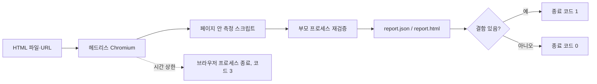

# llm-page-lint

> **English summary** — A command-line linter that opens an LLM-generated HTML page in headless Chromium and measures 8 kinds of visual defects (overlapping, clipped or off-screen text, empty boxes, cut images, low contrast over images, orphan punctuation, self-changing text) without any reference image. Use it as a CI gate for AI-generated pages: exit code 1 means defects were found. Run: `git clone https://github.com/LeeGyeongPil/llm-page-lint && cd llm-page-lint && npm ci && npx playwright install chromium --only-shell && npm run build && npm start`. Findings are re-validated in the parent process, and a hard `--timeout` kills the browser so unattended runs cannot hang. A judge-and-fix loop is planned for a later milestone.

LLM 이 만든 HTML 페이지를 헤드리스 브라우저로 열어서, 눈으로 봐야 알던 레이아웃 결함을 **숫자로 재고** 통과·실패(종료 코드)로 알려 주는 검사기입니다.

인쇄 전 교정지를 떠올리면 쉽습니다. 교정자는 정답 원고 없이도 글자가 겹친 곳, 잘린 곳, 줄 끝에 마침표만 남은 곳에 빨간 펜으로 동그라미를 칩니다. 이 도구는 같은 일을 브라우저에서 규칙과 숫자로 하고, 사람이 매번 화면을 훑어보는 수고를 덜어 줍니다.


*결함 8종이 하나씩 들어 있는 샘플 페이지를 검사한 결과. 종류별 개수와 위치가 나오고, 결함이 있으니 종료 코드는 1입니다.*

## 이런 분께
- LLM 이 만든 HTML(랜딩 페이지·리포트·슬라이드)을 사람이 눈으로 훑지 않고 자동으로 걸러 내고 싶은 분
- "기준 스크린샷" 없이, 페이지 하나만 보고 깨진 곳을 찾고 싶은 분
- 생성 → 검사 → 수정 파이프라인을 무인으로 돌리는 CI 에 회귀 방지 게이트가 필요한 분

## 설치
필요한 것: Node.js 22 이상(`brew install node` 또는 https://nodejs.org). 리눅스 최소 환경에서는 Chromium 실행에 필요한 시스템 라이브러리가 따로 필요하며, 아래 `--with-deps` 옵션이 설치해 줍니다(root 권한 필요).

```bash
git clone https://github.com/LeeGyeongPil/llm-page-lint
cd llm-page-lint
npm ci
npx playwright install chromium --only-shell          # 리눅스: npx playwright install --with-deps chromium --only-shell
npm run build
```

아직 npm 레지스트리에는 올리지 않았습니다. 위처럼 clone 해서 쓰세요.

## 빠르게 시작하기
```bash
npm start
```
내장된 샘플 페이지(`fixtures/defects.html`)를 검사해 결함 표와 보고서 경로를 보여 줍니다. 이 명령은 항상 종료 코드 0 으로 끝나는 체험용입니다(실제 `check` 는 결함이 있으면 1).

내 페이지를 검사하려면:
```bash
node dist/cli.js check fixtures/defects.html --viewports 1024 --out /tmp/lint-out
echo $?        # 1 = 결함 있음
```
실제 출력은 다음과 같습니다(위 스크린샷과 같은 내용).
```
checked 1 page render(s) at 1024px in 1.65s

kind                      count
------------------------  -----
orphan_punct                  1
overlap_text                  1
clipped_text                  1
offscreen_text                1
empty_box                     1
cut_image                     1
low_contrast_over_image       1
changing_text                 1

- orphan_punct @1024px #s-orphan > p.col [orphan] text=. line=3
- overlap_text @1024px #s-overlap > h2 [overlap] other=#s-overlap > h3 areaPx=6377 overlapHeight=23
- clipped_text @1024px #s-clip > div.card [clip] hiddenPx=47 axis=y
- offscreen_text @1024px #s-off > p.lost:nth-of-type(2) [offscreen] side=right overflowPx=364
- empty_box @1024px #s-empty > div.box [empty] areaPx=46816
- cut_image @1024px #s-img > img [image] clipper=#s-img cutPx=80 visibleRatio=0.56
- low_contrast_over_image @1024px #s-hero > p [hero] ratio=1.17 need=3 color=rgb(255, 255, 255)
- changing_text @1024px #s-timer > p [timer] before=Offer ends in 10:00 after=Offer ends in 9:58 intervalMs=1200

8 findings
report: /tmp/lint-out/report.html
```
각 줄은 `결함 종류 @뷰포트 너비 · CSS 선택자 · 섹션 이름 · 측정값` 입니다. 예를 들어 `ratio=1.17 need=3` 은 글자와 배경의 명암비가 1.17 인데 최소 3 이 필요하다는 뜻입니다.

`report:` 줄은 절대 경로로 나옵니다(위 `/tmp/lint-out` 은 예시). 같은 폴더에 `report.json`(기계용)과 `report.html`(사람용, 스크린샷 내장·외부 주소 없음)이 생깁니다. `report.html` 은 파일을 더블클릭하면 열립니다.


*`report.html` 의 페이지 스크린샷. 번호가 붙은 상자가 결함 위치이고, 그 아래에 번호별 결함 표와 이미지 위 글자 대비 표가 이어집니다.*

## 잡는 결함 8종
출력에 나오는 종류 이름의 뜻입니다. 모든 기준값은 코드(`src/browser/detect.ts`, `src/contrast.ts`)에 있는 값이며, 기준 이미지 없이 이 규칙만으로 판정합니다.

| 종류 | 이런 화면입니다 | 측정 방법 | 기준값 |
|---|---|---|---|
| `orphan_punct` | 줄 맨 앞에 마침표·쉼표·닫는 괄호만 남음 | `Range` 로 실제 그려진 줄을 얻어, 2번째 이후 줄이 닫는 문장부호로 시작하는지 확인 | 닫는 부호 1글자로 시작 |
| `overlap_text` | 서로 다른 블록의 글자가 겹쳐 읽을 수 없음 | 줄 상자끼리 교차 면적 계산(잘려서 안 그려지는 줄은 제외) | 교차 20px² 초과 |
| `clipped_text` | `overflow: hidden` 상자 밖으로 글자가 나가 잘림 | 줄 상자가 잘라내는 상자 경계를 넘은 길이 | 2px 초과 |
| `offscreen_text` | 글자가 화면 왼쪽·오른쪽·위쪽 밖 | 블록 경계와 뷰포트 너비 비교(스크롤 상자 안은 제외) | 1px 초과 |
| `empty_box` | 배경·테두리는 있는데 안에 글자·이미지가 없는 큰 상자 | 꾸민 상자의 안쪽 글자·미디어 유무 | 면적 5000px² 이상 |
| `cut_image` | 이미지가 섹션 경계에 걸려 일부만 보임 | 이미지 사각형과 잘라내는 조상 상자의 교집합 | 보이는 비율 0.02 초과 0.98 미만이고 잘린 길이 2px 초과 |
| `low_contrast_over_image` | 사진·그라디언트 위 글자가 배경과 구분되지 않음 | 글자를 투명하게 만든 뒤 배경만 캡처하고, 글자 영역 픽셀의 하위 10% 분위 명암비(WCAG 공식)를 계산 | 보통 글자 4.5:1, 큰 글자(24px 이상, 또는 18.66px 이상 굵은 글자) 3:1 |
| `changing_text` | 카운트다운·시세처럼 스스로 바뀌는 글자 | 모든 텍스트 블록을 1.2초 간격으로 두 번 읽어 비교(첫 뷰포트에서만) | 글자가 달라짐 |

예를 들어 앞의 `ratio=1.17 need=3` 에서 `need=3` 은 그 글자가 큰 글자라 기준이 3:1 이라는 뜻입니다. 위 숫자는 `fixtures/defects.html` 이 만들어 내는 결과와 코드로 확인한 값이며, 규칙을 바꾸려면 위 두 파일을 보세요.

## 사용법
| 명령·옵션 | 하는 일 | 예 |
|---|---|---|
| `check <입력...>` | 검사. 입력은 `.html` 파일·폴더·http(s) URL | `check page.html` |
| `--viewports <목록>` | 화면 너비(px) 목록. 기본 375,768,1280 | `--viewports 375,1280` |
| `--out <폴더>` | 보고서 저장 위치. 기본은 `~/.cache/llm-page-lint/runs/`(`$XDG_CACHE_HOME` 가 있으면 그 아래)이며 마지막 줄에 경로 출력(리눅스에서 `XDG_CACHE_HOME` 만 바꾸면 브라우저 위치도 바뀌므로 아래 설정 절 참고) | `--out /tmp/lint-out` |
| `--json` | 요약 대신 JSON 보고서를 표준 출력으로 | `--json > r.json` |
| `--fail-on <종류,...>` | 이 종류만 종료 코드 1 에 반영, 나머지는 경고 | `--fail-on clipped_text` |
| `--ignore <선택자>` | 해당 요소(와 안쪽)는 검사 제외(여러 번 가능) | `--ignore .ad-slot` |
| `--timeout <ms>` | 전체 시간 상한(기본 60000). 넘으면 종료 코드 3 | `--timeout 2000` |
| `--no-changing-text` | 1.2초 간격으로 두 번 읽는 "바뀌는 글자" 검사 생략 | |
| `demo` | 내장 샘플 검사(항상 종료 코드 0) | `npm start` |

`refine`(판정·수정 루프)는 아직 문서화하지 않은 실험 기능이라 이 문서의 범위에 넣지 않았습니다.

종료 코드: `0` 결함 없음 / `1` 결함 있음 / `2` 사용법·실행 오류 / `3` 시간 초과.

### 시나리오 1 — 깨끗한 페이지는 통과
```bash
node dist/cli.js check fixtures/clean.html fixtures/false-positives.html --viewports 1024 --out /tmp/lint-out
```
```
checked 2 page render(s) at 1024px in 2.89s

kind                      count
------------------------  -----
(none)

0 findings
report: /tmp/lint-out/report.html
```
종료 코드 0. `false-positives.html` 은 스크린 리더 전용 숨김 텍스트처럼 **겉보기엔 이상해도 정상인** 경우를 모아 둔 페이지라서, 오탐이 없는지 확인하는 용도입니다.


*결함이 없으면 `(none)` 과 `0 findings`.*

### 시나리오 2 — 멈춘 페이지는 시간 상한으로 끊기
```bash
node dist/cli.js check fixtures/hang.html --timeout 2000 --out /tmp/lint-out
```
```
error: timed out after 2000 ms — the page may be stuck in a script loop (browser was closed)
```
종료 코드 3. 무한 루프에 빠진 페이지가 있어도 무인 파이프라인이 멈추지 않도록 브라우저 프로세스를 직접 종료합니다.


*시간 상한을 넘기면 브라우저를 닫고 종료 코드 3 으로 끝납니다.*

### 시나리오 3 — 일부 종류만 실패로 취급
```bash
node dist/cli.js check fixtures/defects.html --viewports 1024 --fail-on clipped_text --no-changing-text --out /tmp/lint-out
```
마지막 줄 근처에 `7 findings (1 count toward the exit code)` 가 나옵니다. `--no-changing-text` 로 바뀌는 글자 검사를 뺐으므로 8건이 아닌 7건이고, 그중 `clipped_text` 1건만 종료 코드에 반영되며 나머지는 경고입니다. 처음 도입할 때 규칙을 하나씩 켜 가는 용도입니다.

### 시나리오 4 — 라이브러리로 쓰기
```js
import { lint } from './dist/index.js';
const file = 'fixtures/defects.html';
const report = await lint({ file }, { viewports: [1024] });
console.log(`${report.findings.length} findings in ${file}`);
for (const f of report.findings) console.log(`- ${f.kind} ${f.selector}`);
```
저장소에 거의 같은 예제가 들어 있습니다(파일 경로를 절대 경로로 출력하는 점만 다릅니다).
```bash
node examples/api.mjs
```
```
8 findings in <파일 경로>/fixtures/defects.html
- orphan_punct #s-orphan > p.col
- overlap_text #s-overlap > h2
- clipped_text #s-clip > div.card
- offscreen_text #s-off > p.lost:nth-of-type(2)
- empty_box #s-empty > div.box
- cut_image #s-img > img
- low_contrast_over_image #s-hero > p
- changing_text #s-timer > p
```

*`lint()` 는 `findings` 배열이 담긴 보고서 객체를 돌려줍니다. 입력은 `{file}`·`{url}`·`{html}` 중 하나.*

### 라이브러리 API
아래 표의 함수와 `LintOptions` 가 공개 API 입니다. `VERSION`·`DEFAULT_VIEWPORTS`·`MAX_FINDINGS`·`FINDING_KINDS` 상수와 `luminance`·`installGuards` 도 내보냅니다. `refine`·`MockJudge`·`MockFixer`·`OpenAIJudge`·`OpenAIFixer`·`configFromEnv`(다듬기 루프)와 `LintOptions.onBrowser` 는 실험·시험용이라 바뀔 수 있습니다.

| 함수 | 인자 | 돌려주는 값 |
|---|---|---|
| `lint(input, opts?)` | `input`: `{file}`·`{url}`·`{html, baseDir?}` 중 하나 또는 그 배열. `opts`: `LintOptions` | `Promise<LintReport>` (`findings`, `contrast`, `pages`, `rejectedFromBrowser`, `seconds` 등). 시간 초과면 `LintTimeoutError`, 브라우저가 없으면 `BrowserMissingError`, 입력 오류면 `InputError` |
| `detectPage(page, opts?)` | Playwright `Page`(직접 연 페이지), `opts`: `ignore`·`changingText` | `Promise<Finding[]>` |
| `validateFindings(raw, viewport)` | 브라우저가 돌려준 원시 값, 뷰포트 너비 | `{ ok: Finding[], rejected: number }` (모양이 틀린 항목은 버림. 원시 값이 `MAX_FINDINGS`=5000건을 넘으면 예외) |
| `contrastRatio(a, b)` | 두 `RGB`(`[r, g, b]`) | WCAG 명암비(1~21) |

`LintOptions` 필드(모두 선택):

| 필드 | 기본값 | 뜻 |
|---|---|---|
| `viewports` | `[375, 768, 1280]` | 화면 너비 목록(px) |
| `timeoutMs` | `60000` | 전체 시간 상한 |
| `changingText` | `true` | 바뀌는 글자 검사 |
| `ignore` | 없음 | 검사에서 뺄 CSS 선택자 목록 |
| `screenshots` | `false` | 보고서용 스크린샷도 찍기 |

## 설정
- 환경변수 `PLAYWRIGHT_BROWSERS_PATH` — Chromium 설치 위치. 기본은 Playwright 사용자 캐시(macOS `~/Library/Caches/ms-playwright`, 리눅스 `~/.cache/ms-playwright`)이며, 다른 곳에 설치했을 때만 지정합니다. 리눅스에서는 Playwright 가 `$XDG_CACHE_HOME/ms-playwright` 를 보므로, 보고서 위치를 옮기려고 `XDG_CACHE_HOME` 을 바꿨다면 `PLAYWRIGHT_BROWSERS_PATH=~/.cache/ms-playwright` 도 함께 지정하거나 `--out` 을 쓰세요.
- 환경변수 `LLM_PAGE_LINT_BROWSER_ARGS` — Chromium 에 줄 추가 플래그. 컨테이너 CI 에서는 `--no-sandbox`.
- `LLM_PAGE_LINT_BASE_URL`·`LLM_PAGE_LINT_API_KEY`·`LLM_PAGE_LINT_JUDGE_MODEL`·`LLM_PAGE_LINT_FIXER_MODEL` — 다음 마일스톤의 `refine` 에서 모델 판정을 연결할 때만 쓰는 값입니다(`.env.example` 참고). `check` 는 모델도 키도 필요 없습니다.

## 동작 원리

1. **헤드리스 Chromium 으로 렌더링**: 화면 없이 실제 브라우저로 페이지를 그립니다. 뷰포트(화면 너비)마다 한 번씩 그립니다.
2. **페이지 안 측정 스크립트**: 글자가 있는 요소마다 `Range` 로 "실제로 그려진 줄"의 사각형을 얻어, 서로 겹치는지·잘렸는지·화면 밖인지·줄 맨 앞에 마침표만 남았는지를 계산합니다. 정답 이미지는 필요 없고, 결함은 규칙이 정의합니다.
3. **이미지 위 글자 대비**: 글자를 투명하게 만든 뒤 배경만 캡처하고, 글자 영역 픽셀의 하위 10% 분위 명암비(WCAG 공식)를 잽니다. 그라디언트·사진 위 글자도 픽셀로 확인합니다.
4. **부모 측 재검증**: 페이지 안의 스크립트가 돌려준 결과를 그대로 믿지 않고, 종류·좌표·문자열 길이·개수를 Node 쪽에서 다시 검사해 모양이 틀린 항목은 버립니다. 악의적인 페이지가 결함을 위조하거나 숨기기 어렵게 하려는 장치입니다(`fixtures/hostile.html` 로 시험). 한계는 아래 "신뢰 경계"에 적었습니다.
5. **시간 상한**: 페이지가 스크립트 루프에 빠지면 `browser.close()` 가 돌아오지 않습니다. 그래서 브라우저 서버 프로세스를 직접 종료해 `--timeout` 을 지킵니다.

코드에서 볼 곳: `src/browser/detect.ts`(측정), `src/contrast.ts`(대비), `src/validate.ts`(재검증), `src/render.ts`(브라우저 실행·종료).

## 신뢰 경계
이 도구는 **신뢰할 수 없는 페이지를 안전하게 격리해 주지 않습니다.** 검사 대상 페이지의 스크립트는 헤드리스 브라우저 안에서 그대로 실행됩니다.
- 측정 스크립트가 쓰는 브라우저 기본 함수(`getBoundingClientRect` 등)는 페이지 스크립트가 실행되기 전에 원본을 잡아 두고 바꿀 수 없게 고정합니다(`src/browser/init.ts`).
- 그래도 완전한 격리는 아닙니다. 고정하지 않은 값(요소별 크기 getter 등)은 페이지가 덮어쓸 수 있습니다. 그래서 Node 쪽에서 종류·좌표 범위·문자열 길이·개수(최대 5000건)를 다시 검사해 모양이 틀린 항목을 버립니다. 이 재검증은 "모양이 틀린 결과"를 걸러낼 뿐, 그럴듯하게 꾸민 거짓 결과까지 가려내지는 못합니다.
- 시간 상한(`--timeout`)은 무한 루프로부터 파이프라인을 지켜 줍니다.
- 출처를 모르는 URL·HTML 은 컨테이너 같은 격리된 환경에서 검사하세요.

## 한계와 오탐
- **의도한 겹침**(배지, 이미지 위 캡션), **캐러셀**처럼 일부러 겹치거나 잘라 둔 디자인은 결함으로 잡힐 수 있습니다. 이때는 `--ignore '.badge'` 처럼 선택자로 빼거나, `--fail-on` 으로 실패로 취급할 종류만 고르세요.
- 글꼴·운영체제가 다르면 줄바꿈 위치가 달라져 결과가 달라질 수 있습니다. CI 에서는 `mcr.microsoft.com/playwright` 같은 고정된 Docker 이미지로 실행하고 뷰포트를 고정하길 권합니다.
- 대비는 글자 영역의 픽셀 표본(하위 10% 분위)으로 추정한 값이라 경계에 가까운 값은 사람이 한 번 더 보는 편이 좋습니다.
- 접근성 전반(구조·ARIA·키보드)은 다루지 않습니다. 그런 검사는 axe-core 같은 도구와 함께 쓰세요.

## 언제 쓰나
- 기준 스크린샷 없이 새로 생성한 HTML 의 겹침·잘림 같은 레이아웃 결함을 CI 에서 종료 코드로 거르고 싶을 때 맞습니다.
- 접근성 전반을 검사할 때는 [axe-core](https://github.com/dequelabs/axe-core) 를 보세요.
- 이전 버전과의 픽셀 차이를 확인할 때는 시각 회귀 도구(예: [Playwright 스크린샷 비교](https://playwright.dev/docs/test-snapshots))를 보세요.

## 자주 겪는 문제
| 증상 | 원인 | 해결 |
|---|---|---|
| `headless Chromium for Playwright is not installed` 오류(종료 코드 2) | Chromium 미설치 | `npx playwright install chromium --only-shell` |
| 리눅스에서 `XDG_CACHE_HOME` 을 바꾼 뒤 `headless Chromium ... is not installed` (뒤에 `note: on Linux Playwright looks in $XDG_CACHE_HOME/ms-playwright` 안내가 붙음) | 리눅스의 Playwright 는 브라우저를 `$XDG_CACHE_HOME/ms-playwright` 에서 찾는데 Chromium 은 `~/.cache/ms-playwright` 에 설치됨 | `PLAYWRIGHT_BROWSERS_PATH=~/.cache/ms-playwright` 지정, 또는 `XDG_CACHE_HOME` 대신 `--out` 으로 보고서 위치 지정 |
| 리눅스에서 브라우저가 바로 종료 | 시스템 라이브러리 부족 | `npx playwright install --with-deps chromium --only-shell` |
| 컨테이너·CI 에서 SIGTRAP 으로 실패 | 샌드박스 권한 | `LLM_PAGE_LINT_BROWSER_ARGS=--no-sandbox` |
| 종료 코드 3 | 페이지가 스크립트 루프에 빠졌거나 `--timeout` 이 너무 짧음 | 값을 늘리거나 페이지의 스크립트를 점검 |
| 컴퓨터마다 줄바꿈 위치·결과가 다름 | 글꼴 차이 | CI 에서는 고정된 Docker 이미지로 실행, 뷰포트 고정 |
| 보고서를 못 찾겠음 | `--out` 을 안 줌 | 출력 마지막 줄의 `report:` 경로 확인(기본 `~/.cache/llm-page-lint/runs/`) |
| 캐시 폴더가 계속 쌓임 | `--out` 없이 실행할 때마다 새 폴더가 생김 | 필요 없으면 `~/.cache/llm-page-lint/runs/` 안을 지움. 실패·시간 초과한 실행은 폴더를 남기지 않음 |
| `check fixtures` 가 종료 코드 3 | 폴더 안의 `hang.html` 은 일부러 멈추는 시험용 페이지 | 정상입니다. 개별 파일을 지정하거나 `--timeout` 을 짧게 |
| `error: invalid viewport width "abc" ...`, `--timeout must be at least 1000 ms` (종료 코드 2) | 옵션 값이 잘못됨 | 메시지에 나온 값과 예시(`--viewports 375,1280`)를 확인 |
| `detector returned N findings (limit 5000)` | 같은 요소가 아주 많이 반복되는 페이지 | `--ignore <선택자>` 로 반복 요소를 빼거나 페이지를 나눠 검사 |

## 개발·기여
```bash
npm test      # 빌드 후 27개 시험(키·모델 불필요)
```
버그·제안은 이슈로 남겨 주세요. 변경 기록은 [CHANGELOG.md](CHANGELOG.md).

## 라이선스
MIT. 의존성은 각자의 라이선스를 따릅니다.

| 의존성 | 용도 | 라이선스 |
|---|---|---|
| playwright | 헤드리스 Chromium 제어 | Apache-2.0 |
| pngjs | 스크린샷 픽셀 읽기 | MIT |
| parse5 | HTML 해석 | MIT |
| axe-core (개발용) | `compare:axe` 비교 시험에서만 사용 | MPL-2.0 |
